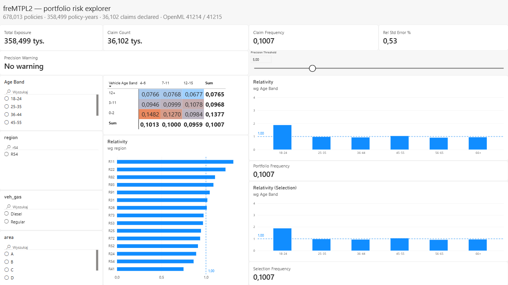
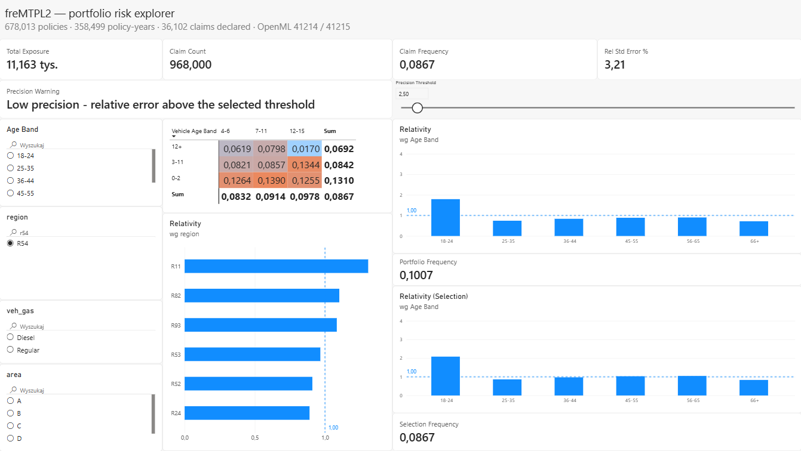

# freMTPL2 — Insurance Pricing Analytics in PostgreSQL

An analysis of 678,013 French motor third-party liability policies and the
26,639 claims filed against them. The repository loads two raw CSV files into a normalised PostgreSQL schema,
counting and documenting the inconsistencies it finds on the way. It then asks which risk
characteristics raise claim frequency, by how much, and how far those numbers can be
trusted.

Everything runs locally: `docker compose up -d`, one Python loader, a handful of SQL files.

---

## Why this project

I wanted a SQL project on real data rather than a generated toy set. freMTPL2 is a
public dataset used in actuarial teaching and research, and it comes as two tables in a
one-to-many relationship — policies and the claims filed against them. That shape is
what makes SQL the right tool here.

Two decisions shape the repository:

- small segments are measured too imprecisely to rank, so they are reported only where
  the number of claims behind them supports it;
- the source data is inconsistent, and every inconsistency here is counted and documented
  rather than dropped by the loader.

---

## Data

**Source:** OpenML — [freMTPL2freq (id 41214)](https://www.openml.org/d/41214) and
[freMTPL2sev (id 41215)](https://www.openml.org/d/41215).

**Licence:** OpenML lists both datasets as CC0; the upstream R package `CASdatasets`,
from which they originate, is GPL-2.0.

**Row counts as loaded:**

| Table | Rows |
|---|---|
| policies (`freMTPL2freq`) | 678,013 |
| claims (`freMTPL2sev`) | 26,639 |

The OpenML description page states 677,991 policies. The figure above is what actually
loaded and was counted in the database.

**Relationship:** one policy → zero or more claims, joined on `id_pol`.

### Columns

**`freMTPL2freq`** — one row per policy:

| Column | Meaning                                                                                                  |
|---|----------------------------------------------------------------------------------------------------------|
| `id_pol` | policy identifier                                                                                        |
| `claim_nb` | number of claims declared on the policy                                                                  |
| `exposure` | fraction of a year the policy was active; observed range 0.0027 to 2.01 |
| `veh_power` | engine power as an ordered code from 4 to 15, not horsepower                                             |
| `veh_age` | vehicle age in years                                                                                     |
| `driv_age` | driver age in years                                                                                      |
| `bonus_malus` | no-claims scale; below 100 a discount, above 100 a surcharge                                             |
| `veh_brand` | anonymised make; 11 distinct codes in the range B1–B14                                                   |
| `veh_gas` | fuel type, Regular or Diesel                                                                             |
| `area` | population density band, A to F                                                                          |
| `density` | inhabitants per square kilometre where the policyholder lives - the same information as `area`, unbanded |
| `region` | French region code                                                                                       |

**`freMTPL2sev`** — one row per claim:

| Column | Meaning |
|---|---|
| `id_pol` | the policy this claim belongs to; the only link between the two files |
| `claim_amount` | settled amount of one claim, in EUR |
---

## Architecture

Data lands in a `raw` schema that carries no constraints at all. Every row from the
source files loads, including the broken ones — a constraint here would abort the import
instead of producing a count of what is wrong.

`sql/01_schema_raw.sql` and `sql/02_schema_core.sql` create the two schemas, and
`scripts/load.py` fills `raw` with `COPY`. `sql/03_audit.sql` then measures what came
in. `sql/04_promote.sql` runs last, moving rows into `core`, where keys, types and `CHECK`
constraints are enforced. Claims whose `id_pol` matches no policy
never reach `core.claim`; they land in `core.claim_quarantine`.

Data flow:
```
data/raw/*.csv  ->  raw.freq, raw.sev  ->  audit  ->  core.policy, core.claim
                    (no constraints)                  (+ core.claim_quarantine)
```

---

## How to run

**Prerequisites:** Docker Desktop, Python 3.x

```bash
cp .env.example .env

pip install "psycopg[binary]" python-dotenv pandas scikit-learn
docker compose up -d

python scripts/download.py              # fetches the datasets into data/raw/

docker compose exec db psql -U fremtpl -d fremtpl -f /sql/01_schema_raw.sql
docker compose exec db psql -U fremtpl -d fremtpl -f /sql/02_schema_core.sql

python scripts/load.py

docker compose exec db psql -U fremtpl -d fremtpl -f /sql/03_audit.sql
docker compose exec db psql -U fremtpl -d fremtpl -f /sql/04_promote.sql
docker compose exec db psql -U fremtpl -d fremtpl -f /sql/05_indexes.sql
docker compose exec db psql -U fremtpl -d fremtpl -f /sql/06_benchmark.sql
```

Every SQL file is idempotent — running it twice leaves the same state.

Expected row counts after promotion: 678,013 policies, 26,444 claims, 195 quarantined.

---

## Schema

**`core.policy`** — one row per policy, `id_pol` as `PRIMARY KEY`. Uniqueness was
verified before the key was declared: 678,013 rows, 678,013 distinct `id_pol`.

**`core.claim`** — one row per claim. `id_pol` repeats here by construction, and two
claims on one policy can carry identical amounts, so no natural key exists. A surrogate
`claim_id INTEGER GENERATED ALWAYS AS IDENTITY` supplies one; without it no individual
claim row could be addressed.

**`core.claim_quarantine`** — no constraints beyond a mandatory `reject_reason`. Rows
arrive here precisely because they failed constraints elsewhere; enforcing any here
would defeat the purpose.

### Type decisions

- **`NUMERIC` for money and exposure**, never floating point — exposure is the
  denominator of every figure here, and float error accumulates across summed rows.
- **`INTEGER` for `id_pol`** — maximum observed 6,114,330, and the same type in all four
  places the key appears, so no join needs an implicit cast.
- **`SMALLINT` for ages and engine power** — ranges two orders of magnitude inside the type.

### Constraints

`CHECK` constraints were added only where the audit confirmed they hold: `claim_nb >= 0`,
`exposure > 0`, `driv_age >= 18`, `veh_gas IN ('Regular','Diesel')`, `area IN ('A'..'F')`.

---

## Data quality findings

| # | Finding                                                                | Measured | Decision |
|---|------------------------------------------------------------------------|---|---|
| 1 | Claim rows referencing a policy that does not exist | 195 rows pointing to 6 distinct policy ids | quarantined with a reject reason; not loaded into `core.claim` |
| 2 | Policies where `claim_nb` disagrees with the number of claim rows | 9,117 policies, all of them declaring more claims than exist | `claim_nb` used for frequency; the claim table used only for severity |
| 3 | `veh_gas` values wrapped in literal apostrophes (`'Regular'`, 9 chars) | all rows | stripped during promotion to `core` |
| 4 | `id_pol` typed float in one source table, integer in the other, observed in the source files at load time       | — | normalised to `INTEGER` after verifying no fractional parts exist |
| 5 | Missing values across all columns of both tables                       | 0 | every column declared `NOT NULL` in `core` |
| 6 | Only part of the claims declared in `claim_nb` have an amount row in the claim file | 73% overall; 48-84% across regions; falls steadily from 85% to 62% with driver age | the missing amounts are not random, so every severity figure rests on a biased subset |
| 7 | `driv_age` spikes at 99 (70 policies against 5 at 98 and 3 at 100); `veh_age` piles up at 99 and 100 with nothing between 86 and 98 | 70 and 48 policies | left as is: sentinel values, together 0.02% of the portfolio, and both fall inside the oldest band |

All numbers were measured by the queries in `sql/03_audit.sql`, which records the result
above each one.

**Why quarantine rather than deletion (row 1).** Dropping the rows would make the
inconsistency invisible and unverifiable. Quarantining keeps every rejected record with
the reason it was rejected, so the decision can be reviewed and reversed.

**Why `claim_nb` for frequency (row 2).** The policy table is the record of exposure
and claim counts; the claim table exists to carry amounts. Counting claim rows instead
would understate frequency by exactly the claims missing from that file. The consequence
is stated rather than hidden: frequency and severity in this repository rest on
different subsets of the data.

---

## Analytical queries

| File                                   | Business question | SQL technique |
|----------------------------------------|---|---|
| `sql/03_audit.sql`                     | Are the two tables mutually consistent, and will every declared constraint hold? | `LEFT JOIN` + `IS NULL`, `GROUP BY` / `HAVING`, row-level `IS NOT NULL` |
| `analysis/q02_fanout.sql`              | What is portfolio claim frequency — and what happens if the join comes first? | fan-out demonstration, two CTEs compared |
| `analysis/q03_frequency_by_region.sql` | Which regions carry above-average risk, among those measured precisely enough to say? | exposure-weighted aggregation, `HAVING` on relative standard error |
| `analysis/q04_frequency_by_age.sql`    | How does claim frequency vary with driver age? | `CASE` bucketing of a continuous variable |
| `analysis/q05_risk_grid.sql`           | Do vehicle age and engine power interact? | one- and two-dimensional `GROUP BY`, `percentile_cont` for bucket selection |
| `analysis/q06_severity.sql`            | What does a claim cost, and does that differ by driver age? | join without fan-out, `percentile_cont` for a skewed distribution |
| `analysis/q07_relativity.sql`          | How does each segment compare to the portfolio as a whole? | window functions: `RANK() OVER`, `sum(sum(x)) OVER ()` |

### A note on exposure weighting

Claim frequency here is always `SUM(claim_nb) / SUM(exposure)`, never an average of
per-policy ratios. Dividing sums weights each policy by its share of exposure, so a
one-week policy does not count the same as a one-year one.

The same applies one level up. Averaging the six age-band frequencies in this repository
gives 0.1120; the portfolio figure is 0.1007. The youngest band has the highest frequency
and 3.5% of the exposure, but a plain average hands it one-sixth of the weight.

---

## Performance

Two indexes were added, on the columns the analytical queries join and filter on:
`core.claim(id_pol)` and `core.policy(driv_age)`. PostgreSQL indexes a `PRIMARY KEY`
automatically but not a `FOREIGN KEY`, so `core.claim.id_pol` — the column every
analytical join runs through — had none until this step.

Each benchmark query was timed in both states: without indexes and with them in
place.

### Method

Timings are `Execution Time` from `EXPLAIN ANALYZE`. Each query was run at least five times
with the indexes in place and at least five with them dropped; the first run of each set is
discarded as a warm-up and the median of the rest is reported.

Environment: PostgreSQL 16.15 in Docker, default configuration except `shm_size=256mb`.

### Results

| Query | Before    | After    | Index | Speed-up |
|---|-----------|----------|---|----------|
| all claims for one policy | 0.828 ms  | 0.033 ms | `core.claim(id_pol)` | **25x**  |
| policies of a single driver age | 15.076 ms | 0.621 ms | `core.policy(driv_age)` | **24x**  |

The plans confirm the mechanism: `Seq Scan` before, `Bitmap Index Scan` after.

The queries are in `sql/06_benchmark.sql`, the indexes in `sql/05_indexes.sql`.

One detail from the same run: for the single-policy lookup, planning time (0.058 ms) now
exceeds execution time (0.029 ms) — deciding how to run the query costs more than running
it.

### The negative result

The age-band aggregation (`q07_relativity.sql`) did not get faster, and
no index would make it faster: it reads every row by definition,
so the planner is right to choose a sequential scan.
An index accelerates finding a small subset; where the subset is everything,
it has nothing to offer.

The planner chooses the same sequential scan whether the indexes exist or not, at the same
estimated cost of 12,694.

---

## Power BI model

An interactive report over the same `core` schema: `powerbi/fremtpl2.pbix`.
The model imports `core.policy` and `core.claim` through the PostgreSQL
connector, related one-to-many on `id_pol`. Driver age, vehicle age and engine
power are banded in Power Query using the same cut points as
`sql/analysis/q04_frequency_by_age.sql` and `q05_risk_grid.sql`.
Those steps fold into `CASE WHEN` and run in the database, not locally.
The data is imported rather than queried live, so the file opens and
works without a running database; refreshing it needs one.



### Two baselines, on purpose

The report shows relativity twice. Against the portfolio it answers "how does
this segment compare to the whole book"; against the current selection it
answers "what stands out inside what I am looking at". Selecting a region
moves one and not the other, and the frequency each one divides by is printed
underneath it, so the reader can see which denominator produced which bar.

### The precision threshold is a control, not a constant

`q03_frequency_by_region.sql` drops regions whose relative standard error
exceeds 5%, and `results/findings.md` records that this cutoff is a choice
rather than a measurement. In the report it is a slider. Moving it adds and
removes regions from the ranking and changes when the precision warning
fires, so the cost of that choice is visible instead of described.

The warning itself reacts to the intersection of all four slicers, which no
per-visual filter can anticipate: region, age band, fuel and area are each
reasonable alone and can still leave a handful of claims together.



Region R54 with the threshold at 2.5%: 968 claims, a relative standard error
of 3.21%, the warning lit, and the regional ranking cut to those still clearing
the threshold.

### Reconciliation

Every figure in the report was checked against the SQL output: the portfolio
totals, the six age-band frequencies, the region ranking, and all sixteen
cells and margins of the vehicle age x engine power grid. The model and the
queries agree to four decimal places.

---

## Findings

Portfolio-wide claim frequency: **0.1007** claims per policy-year across 358,499
policy-years of exposure (`q02_fanout.sql`).

- **Regional spread is 1.75x** between the highest and lowest region carrying enough
  claims to be measured (`q03_frequency_by_region.sql`).
- **Driver age dominates.** Drivers under 25 claim 88% more often than the portfolio
  mean; every other band sits within ±10% of it (`q04_frequency_by_age.sql`).
- **Vehicle age is the second effect.** Frequency falls from 0.1377 for cars up to two
  years old to 0.0765 for cars over eleven — a factor of 1.80 (`q05_risk_grid.sql`).
- **Engine power separates the portfolio only once vehicle age is held fixed.** On its
  own the three power bands are indistinguishable from each other. Inside the grid the
  same variable moves frequency from 0.1482 to 0.1270 among cars up to two years old, and
  the other way, 0.0946 to 0.0999, among cars aged 3-11 (`q05_risk_grid.sql`).
- **Young drivers' claims are more extreme, not typically larger.** The median claim is
  about 1,172 EUR in five of the six age bands, but the under-25 tail reaches 28,595 EUR at the 99th
  percentile against 12,000 to 21,000 elsewhere. That tail is enough to leave the band's
  mean the highest even after its single largest claim is removed (`q06_severity.sql`).

Tables, standard errors and caveats: [`results/findings.md`](results/findings.md).

---

## Limitations

**No time dimension.** The files carry no date column, so the portfolio cannot be
split by period. Nothing here says whether risk is rising or falling.

**Frequency and severity rest on different subsets.** `claim_nb` counts 36,102 claims;
the claim table holds 26,444 amounts. The missing 27% are not a random sample: coverage
ranges from 0.481 to 0.841 across regions and falls monotonically from 0.851 to 0.624
across driver age bands, deviations of up to 17 standard errors from the portfolio mean
of 0.733. Coverage does not move with the number of claims on a policy: it sits within 0.7 standard
errors of the portfolio for `claim_nb` 1 and 2, which carry 35,746 of the 36,102 claims.
Frequency is unaffected — its numerator and denominator both come from the policy table —
but every severity figure rests on that biased subset, and the age comparison is the one
most exposed, since coverage varies with the very variable being compared.

**Nothing is isolated.** Every figure breaks the portfolio down by one or two variables;
everything else is left to vary, so a gap between two regions carries whatever else
differs between them - who lives there and what they drive. Engine power shows what that
costs: the variable looks inert on its own and only separates the portfolio once vehicle
age is held constant. Nothing here rules out the same for driver age and region, which are only
ever examined alone.

**One claim dominates the under-25 band.** The portfolio's largest claim, 4,075,400.56 EUR,
is left in the band where it occurred and no adjustment is made for it. It carries 34.7%
of that band's entire claim cost and lifts the band's mean from 3,813.90 to 5,838.56;
no other band draws more than 7.0% from its own largest claim. The band remains the most
severe either way - 3,813.90 against 2,287.85 for the next highest (`q06_severity.sql`).

**Small segments are dropped, not estimated.** Queries that cut on relative standard
error remove 7 of the 22 regions outright, so the results say nothing about them. The 5%
cutoff is a choice rather than a measurement - a segment just above it is reported as
reliable, one just below is discarded entirely.

---

## Repository layout

```
docker-compose.yml        PostgreSQL 16 service, pinned version, named volume
.env.example              connection settings template
sql/
  01_schema_raw.sql       landing layer, deliberately unconstrained
  02_schema_core.sql      validated layer: keys, types, CHECK constraints, quarantine
  03_audit.sql            consistency checks, each with its measured result
  04_promote.sql          raw -> core, with quarantine for rejected rows
  05_indexes.sql          the two indexes and ANALYZE
  06_benchmark.sql        EXPLAIN ANALYZE for the three benchmark queries
  analysis/
    q02_fanout.sql        the fan-out trap, on real numbers
    q03_frequency_by_region.sql
    q04_frequency_by_age.sql
    q05_risk_grid.sql
    q06_severity.sql      claim severity, overall and by driver age
    q07_relativity.sql    window functions
scripts/
  download.py             fetches the source data from OpenML into data/raw/
  db.py                   connection string assembled from .env
  load.py                 CSV -> raw layer via COPY
results/
  findings.md             full analytical results: tables, standard errors, caveats
powerbi/
  fremtpl2.pbix           report and model; binary, versioned as a whole
  portfolio_view.png      full page, no filters applied
  precision_warning.png   R54 at a 2.5% threshold, warning active
```